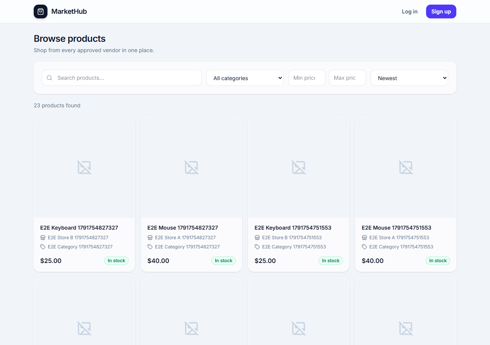
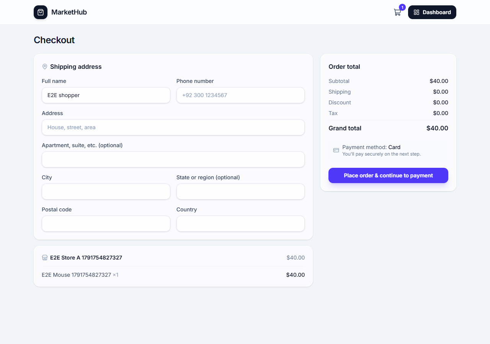
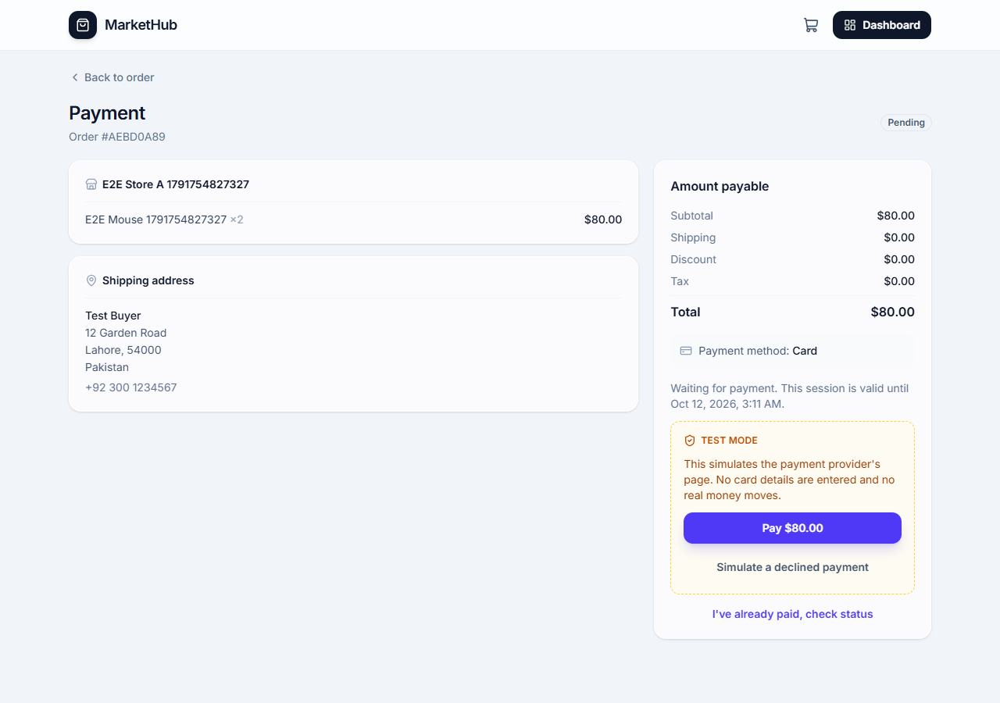
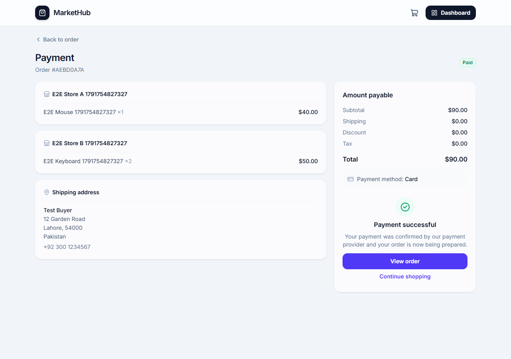
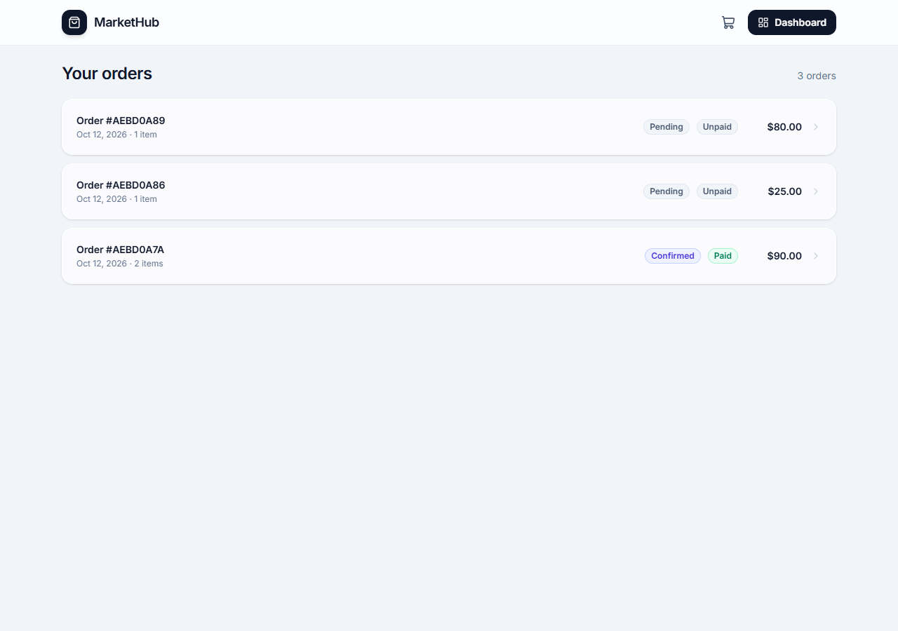
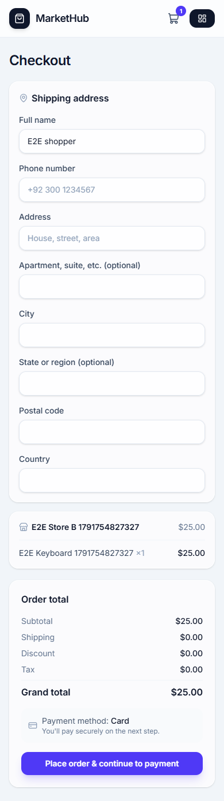
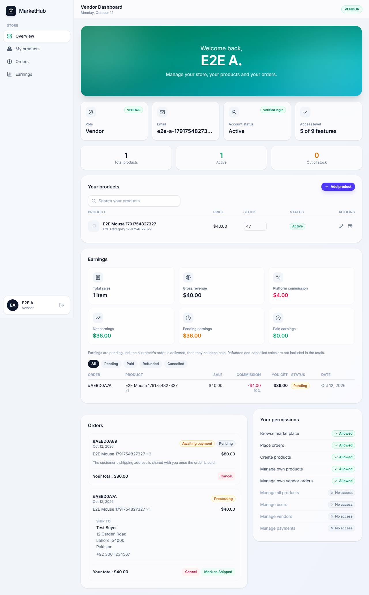
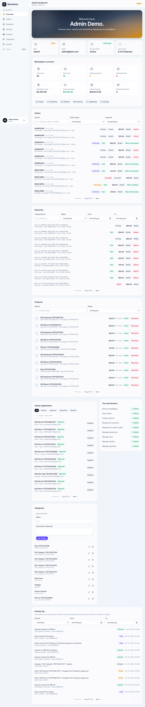
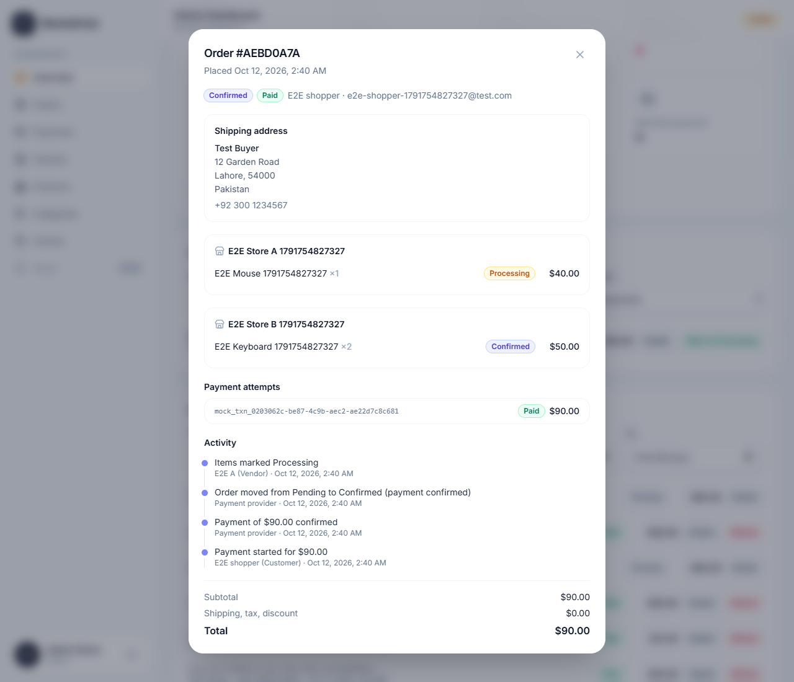
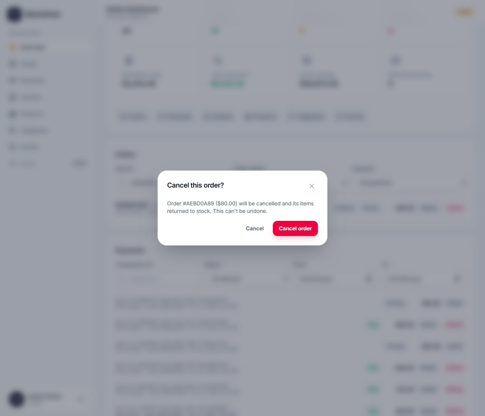

# MarketHub: Multi-Vendor Marketplace

A full-stack marketplace where customers shop, vendors sell, and admins run the platform. Each role gets exactly the access it needs, and every permission is enforced on the backend.

This project is built one day at a time. Each day adds to the same codebase. Snapshots of the project at the end of each day live in `week6/DayN/`.

## Overview

| Role | What they can do |
|---|---|
| **Customer** | Browse and search products, fill a cart from several stores, check out with a shipping address, pay by card, follow their orders |
| **Vendor** | Apply for a store, manage their own products, fulfil the orders that contain their items, see their earnings after the platform's commission |
| **Admin** | Approve or suspend stores, manage categories, moderate products, see every order and payment, issue refunds, read the permanent activity log |

What makes it a marketplace rather than a shop: one cart can hold products from several vendors, and each vendor sees and fulfils **only their own items** of that order. Every price, amount and commission is calculated on the server from the database, never from what the browser sends.

Contents: [Live links](#live-links) · [Tech stack](#tech-stack) · [Project structure](#project-structure) · [Screenshots](#screenshots) · [Running locally](#running-locally) · [Running the tests](#running-the-tests) · [API](#api) · [Roles and permissions](#roles-and-permissions) · [Payment workflow](#payment-workflow) · [Security checklist](#security-checklist) · [Deployment](#deployment) · [Switching to a real payment provider](#switching-to-a-real-payment-provider) · [Test accounts](#test-accounts) · [Test results](#test-results) · [Known issues](#known-issues) · [Day-by-day notes](#day-1-setup-authentication-and-rbac)

## Live links

| | URL |
|---|---|
| Frontend | https://multi-vendor-marketplace-weld.vercel.app |
| Backend API | https://multi-vendor-marketplace-api.vercel.app/api |
| Health check | https://multi-vendor-marketplace-api.vercel.app/api/health |

**Demo accounts:** see [Test accounts](#test-accounts). Anyone can sign up as a customer; admin and vendor credentials are shared privately with the reviewer and are not stored in this repository.

**API testing:** a ready-to-import Postman collection covering every endpoint is at [`postman/MarketHub-API.postman_collection.json`](postman/MarketHub-API.postman_collection.json). Set its `baseUrl` variable, then log in once per role (Admin/Vendor logins auto-save their token).

## Tech stack

| Layer | Tools |
|---|---|
| Backend | Node.js 20, Express 5, MongoDB Atlas, Mongoose 9 (transactions), JWT, bcrypt, express-validator, helmet, express-rate-limit |
| Frontend | React 19, Vite, React Router 7, Tailwind CSS 4, lucide-react |
| Payments | Provider interface with a built-in mock provider (HMAC-signed webhooks); Stripe test mode is a documented drop-in |
| Tests | Jest + Supertest + mongodb-memory-server (backend), Vitest + React Testing Library (frontend), Playwright (end to end), Newman (Postman collection) |
| Hosting | Vercel (backend and frontend as separate projects), MongoDB Atlas |

## Project structure

```
backend/
  expressApp.js          The Express app: helmet, CORS, rate limits, body parsing + sanitising, routes, 404, error handler (no listen, so tests can import it). Deliberately not named app.js: Vercel would pick that as the entry file and skip server.js, which is what connects to MongoDB
  server.js              Starts it: checks required env vars, connects to MongoDB (retrying), listens. It imports express itself and mounts expressApp.js, because Vercel only accepts an entry file that imports express
  constants/              Roles, the vendor/product/order/payment/commission statuses and the audit-log actions -- each in one place
  models/
    User.js               Password hashing, password comparison
    Vendor.js              One store per user, status PENDING/APPROVED/SUSPENDED/REJECTED
    Category.js            Unique name + slug
    Product.js              Belongs to a vendor and a category; auto DRAFT<->ACTIVE<->OUT_OF_STOCK
    Cart.js, CartItem.js    One cart per user; one row per product in that cart (unique index)
    Order.js, OrderItem.js  OrderItem snapshots productName/unitPrice; carries its own fulfillment status
    Payment.js              One row per payment attempt; unique transactionId; refund details; processed webhook event ids
    Commission.js           One row per order item: gross, rate (snapshot), commission, vendor amount, status
    MockTransaction.js      The mock payment provider's own records (stands in for the provider's database)
    AuditLog.js             Append-only activity log: updates and deletes throw
  services/
    stateMachine.js         The one list of allowed order and payment status transitions; every status change asks it
    auditService.js         Writes audit entries (inside the same transaction as the change) and shapes them for the API
    cartService.js          Builds the cart response (vendor-grouped, with per-item availability issues)
    orderService.js         Checkout (the transaction), status-transition rules, cancel + stock release, stale-order cleanup
    paymentService.js       Create/verify/webhook/refund; the single settlePayment transaction behind verify AND webhook
    commissionService.js    Reads COMMISSION_RATE, creates and updates commission rows
    payment/                Provider interface (createIntent, retrieve, refund, verifyWebhook) + the mock provider
  utils/slugify.js, uniqueSlug.js   URL-friendly slugs; products get a random suffix to avoid clashes
  utils/money.js, escapeRegex.js, dateRange.js, pagination.js   Rounding, safe regex search, from/to date filters, page/limit handling
  validators/             Request validation rules, one file per resource (queryRules.js holds the shared page/limit/date rules)
  middleware/
    rateLimit.js           Login, register, checkout, payment, refund, webhook and global limiters
    sanitize.js            Strips keys starting with $ or containing . from request bodies (NoSQL operator injection)
    requestLogger.js       One line per request: method, path, status, time. Never the query string or body
    validate.js            Returns 400 with per-field errors if validation fails
    auth.js                authenticate (401) and requireRole (403)
    loadVendor.js           Loads the caller's store, 403s if it isn't APPROVED
    errorHandler.js         Central error handler (also maps duplicate keys and bad ids to 409/400)
  controllers/, routes/   One pair per resource: auth, vendors, admin vendor management, categories,
                          vendor's own products, the public product catalog, cart, checkout,
                          customer orders, vendor orders, payments, vendor earnings,
                          admin payments, admin orders, admin stats, admin product moderation,
                          admin audit logs
  scripts/seed.js         Creates the demo vendor (with an APPROVED store) and admin
  scripts/setupDb.js      Creates every collection and index (npm run db:setup)
  tests/                  Jest suites (unit/ plus one file per area) and their helpers

e2e/                      Playwright browser tests, kept outside both apps (see e2e/README.md)
postman/                  The Postman collection covering every endpoint
week6/                    End-of-day snapshots of the whole project

frontend/src/
  lib/api.js, format.js   One function for every API call; price/date/stock formatting
  hooks/useApi.js         Generic GET hook: loading/error/data + a reload() for after a mutation
  context/, hooks/        Auth state (AuthProvider/useAuth) and cart state (CartProvider/useCart)
  components/routing/    ProtectedRoute and GuestRoute
  components/ui/         TextField, Select, TextArea, Button, Modal, Badge, Alert, Spinner,
                          QuantityStepper...
  components/dashboard/  Layout, sidebar and dashboard widgets
  components/marketplace/ Public header/layout, product card, filters, pagination
  components/vendor/     Become-a-vendor form, product add/edit modal, product table row,
                          vendor order-management panel, vendor earnings panel
  components/admin/      Vendor application review, category CRUD, marketplace stats,
                          orders panel (with activity timeline), payments panel (with refund),
                          products moderation panel, activity log panel
  components/ui/ConfirmDialog   "Are you sure?" step for every destructive action
  test/                  Test setup and helpers (renderWithProviders, mockApi); *.test.js(x) files sit next to the code they test
  components/cart/, components/orders/   Cart item row; the reusable recent-orders list
  pages/                 Login, Register, three role dashboards, the public marketplace pages,
                          cart, checkout, payment, and order history/detail
```

## Screenshots

Generated by `cd e2e && npm run screenshots` against a running app (test mode, fake data).

| | |
|---|---|
|  **Marketplace** |  **Checkout with shipping address** |
|  **Payment (test mode)** |  **Payment confirmed by the backend** |
|  **My orders** |  **Checkout at 390px** |
|  **Vendor dashboard** |  **Admin dashboard** |
|  **Admin: order activity timeline** |  **Confirmation before a destructive action** |

## Running locally

You need Node.js 20+ and a MongoDB connection string (a free MongoDB Atlas cluster works).

### Backend

```bash
cd backend
npm install
cp .env.example .env    # then fill in the values
npm run db:setup        # creates the collections and indexes (safe to repeat)
npm run seed            # creates the demo vendor and admin
npm run dev             # http://localhost:5000
```

`backend/.env.example` is fully commented, and `backend/.env.production.example` lists the production values (set those in the Vercel dashboard, never in a committed file).

`backend/.env`:

| Variable | Purpose |
|---|---|
| `PORT` | Local port, defaults to 5000 |
| `NODE_ENV` | `development` locally, `production` when deployed. In production Mongoose does not auto-build indexes (use `npm run db:setup`) |
| `DATABASE_URL` | MongoDB connection string, including the database name |
| `JWT_SECRET` | Long random string used to sign tokens |
| `FRONTEND_URL` | The only origin CORS allows, e.g. `http://localhost:5173` (no trailing slash) |
| `BACKEND_URL` | The API's own base URL |
| `PAYMENT_PROVIDER` | `mock` for development. Picks the provider in `services/payment/` |
| `PAYMENT_PUBLIC_KEY` | Provider public key (safe to send to the browser) |
| `PAYMENT_SECRET_KEY` | Provider secret key. Server only, never returned by any endpoint |
| `PAYMENT_WEBHOOK_SECRET` | Shared secret used to sign and verify webhook calls. Use a long random string |
| `COMMISSION_RATE` | Platform commission as a fraction, e.g. `0.10` for 10%. Defaults to `0.10` |
| `SEED_ADMIN_PASSWORD` | Password for `admin@test.com`, used only by `npm run seed` |
| `SEED_VENDOR_PASSWORD` | Password for `vendor@test.com`, used only by `npm run seed` |
| `RATE_LIMIT_DISABLED` | Optional. `true` switches every rate limiter off. Automated tests and local load runs only, never on a deployed server |
| `TRUST_PROXY` | Optional. Any value makes Express trust one proxy hop for the client IP. Vercel is detected automatically |
| `REQUEST_LOG` | Optional. `off` silences the one-line-per-request log |
| `TEST_DATABASE_URL` | Optional, tests only. A database whose name ends in `_test`. Without it the tests use a throw-away in-memory MongoDB |

The server refuses to start if a required variable (including the four `PAYMENT_*` ones) is missing, or if `COMMISSION_RATE` is not between 0 and 1. Generate the webhook secret with `node -e "console.log('whsec_' + require('crypto').randomBytes(32).toString('hex'))"`.

The seed script skips accounts that already exist, so it is safe to run more than once. To change a seeded password, delete that user and run the seed again.

### Frontend

```bash
cd frontend
npm install
cp .env.example .env    # VITE_API_URL=http://localhost:5000/api
npm run dev             # http://localhost:5173
```

`VITE_API_URL` is built into the browser bundle, so it is public. Never put a secret in the frontend `.env`. `frontend/.env.production.example` shows the production value.

## Running with Docker

The whole marketplace (MongoDB + API + web) with one command. You only need [Docker Desktop](https://www.docker.com/products/docker-desktop/); no Node, no Atlas, no `.env` files.

```bash
docker compose up -d --build     # first build takes a few minutes
docker compose ps                # all three should become "healthy"
```

| Service | URL | Image |
|---|---|---|
| `web` | http://localhost:8080 | `frontend/Dockerfile`: Vite build, served by nginx (SPA fallback in `frontend/nginx.conf`) |
| `api` | http://localhost:5000/api (health: `/api/health`) | `backend/Dockerfile`: Node 20 alpine, production deps only, runs as the non-root `node` user |
| `mongo` | internal only | `mongo:7` as a single-node replica set (checkout and payments need transactions) |

The API creates its indexes (`scripts/setupDb.js`) before it starts, and MongoDB data lives in the `mongo-data` volume, so it survives `docker compose down`. Use `docker compose down -v` to start from an empty database.

Fill it with test accounts and demo data (choose your own passwords; they only exist in this local database):

```bash
docker compose exec -e SEED_ADMIN_PASSWORD=<admin pw> -e SEED_VENDOR_PASSWORD=<vendor pw> api node scripts/seed.js
docker compose exec -e API_URL=http://localhost:5000/api -e ADMIN_PASSWORD=<admin pw> -e DEMO_PASSWORD=<demo pw> api node scripts/demo/seedDemo.js
```

Open the app at **http://localhost:8080**, not `127.0.0.1:8080`: CORS allows exactly the `FRONTEND_URL` origin, so another spelling of the same address is blocked by the browser.

The secrets in `docker-compose.yml` are local placeholders. Override any of them from the shell or a root `.env` (for example `JWT_SECRET=...`). Production values live in the hosting dashboards, never in the repository. `docker compose logs -f api` follows the API's request log.

## Running the tests

| What | Command | Needs |
|---|---|---|
| Backend (Jest + Supertest) | `cd backend && npm test` | Nothing: it starts its own in-memory MongoDB replica set (the first run downloads the MongoDB binary). `npm run test:unit` runs only the fast unit tests |
| Frontend (Vitest + React Testing Library) | `cd frontend && npm test` | Nothing |
| End to end (Playwright) | `cd e2e && npm install && npm run e2e` | Backend + frontend running, a seeded admin, `E2E_ADMIN_PASSWORD` set. See [`e2e/README.md`](e2e/README.md) |
| Postman collection | Import `postman/MarketHub-API.postman_collection.json` | Set `baseUrl`; or run it with Newman |

The backend tests never touch your real database: the test database name must end in `_test` or the suite refuses to run. The end-to-end suite creates tagged `E2E ...` data through the API, so point it at a development database.

Run `npm run lint` in `frontend/` before pushing; `npm run build` produces the production bundle.

## API

| Method | Endpoint | Access | Description |
|---|---|---|---|
| GET | `/api/health` | Public | `{ status, database, uptime }`; 503 when the database is down |
| POST | `/api/auth/register` | Public | Creates a customer account |
| POST | `/api/auth/login` | Public | Returns a JWT and the user |
| POST | `/api/auth/logout` | Public | Acknowledges logout (see "Logout" below) |
| GET | `/api/auth/me` | Logged in | Returns the current user |
| GET | `/api/customer/dashboard` | CUSTOMER | Demo protected route |
| GET | `/api/vendor/dashboard` | VENDOR | Demo protected route |
| GET | `/api/admin/dashboard` | ADMIN | Demo protected route |
| POST | `/api/vendors` | CUSTOMER | Submit a vendor application (status starts `PENDING`) |
| GET | `/api/vendors/me` | Logged in | The caller's own vendor application, or `null` |
| GET | `/api/vendors` | Public | List approved stores, `?page=&limit=` |
| GET | `/api/vendors/:id` | Public | One approved store's public info |
| GET | `/api/admin/vendors` | ADMIN | List vendor applications, `?status=&search=&page=&limit=` |
| GET | `/api/admin/vendors/:id` | ADMIN | One vendor application |
| PATCH | `/api/admin/vendors/:id/status` | ADMIN | Set `APPROVED`, `REJECTED` or `SUSPENDED` |
| GET | `/api/categories` | Public | List categories |
| POST | `/api/categories` | ADMIN | Create a category (slug is generated from the name) |
| PATCH | `/api/categories/:id` | ADMIN | Update a category |
| DELETE | `/api/categories/:id` | ADMIN | Delete, blocked with 409 if a product still uses it |
| POST | `/api/vendor/products` | VENDOR, approved store | Create a product (defaults to `DRAFT`) |
| GET | `/api/vendor/products` | VENDOR, approved store | The caller's own products, `?status=&search=&page=&limit=`, plus a store-wide summary |
| GET \| PATCH | `/api/vendor/products/:id` | VENDOR, approved store | Read or update **your own** product only |
| DELETE | `/api/vendor/products/:id` | VENDOR, approved store | Archive (soft delete) your own product |
| GET | `/api/products` | Public | Active products only. `?search=&category=&vendor=&minPrice=&maxPrice=&sort=&page=&limit=` |
| GET | `/api/products/:id` | Public | One active product, with its vendor and category |
| GET | `/api/cart` | Logged in | The caller's cart, grouped by vendor, with per-item `issue` warnings |
| POST | `/api/cart/items` | Logged in | Add a product (merges into the existing row if it's already there) |
| PATCH | `/api/cart/items/:id` | Logged in | Change an item's quantity |
| DELETE | `/api/cart/items/:id` | Logged in | Remove an item |
| POST | `/api/checkout` | Logged in | Body `{ shippingAddress }`. Re-validates the whole cart and creates the order, atomically |
| GET | `/api/orders` | Logged in | The caller's own orders, `?page=&limit=` |
| GET | `/api/orders/:id` | Logged in | One of the caller's own orders, with its items |
| GET | `/api/vendor/orders` | VENDOR, approved store | Orders containing this vendor's products, **their items only**, `?page=&limit=` |
| GET | `/api/vendor/orders/:id` | VENDOR, approved store | Same scoping, for one order |
| PATCH | `/api/vendor/orders/:id/status` | VENDOR, approved store | Advance or cancel this vendor's segment of the order |
| POST | `/api/payments/create` | Logged in | Start (or resume) a payment for one of **your** orders. Only the order id is sent; the amount comes from the order |
| GET | `/api/payments/order/:orderId` | Logged in | Your latest payment attempt for that order, or `{ payment: null }` |
| POST | `/api/payments/verify` | Logged in | Asks the provider for the real status, checks amount + order, then settles the payment |
| POST | `/api/payments/webhook` | Provider (signed) | Signature-verified, idempotent payment events. No login: the signature is the authentication |
| POST | `/api/payments/mock/pay` | Logged in, `PAYMENT_PROVIDER=mock` only | Development stand-in for the customer paying on the provider's page |
| GET | `/api/vendor/earnings` | VENDOR, approved store | Summary (sales, commission, net, paid, pending) + paginated history, `?status=&from=&to=&page=&limit=` |
| GET | `/api/admin/payments` | ADMIN | List payments, `?search=` (transaction id) `&status=&from=&to=&page=&limit=` |
| GET | `/api/admin/payments/:id` | ADMIN | One payment with its customer, order and items |
| POST | `/api/admin/payments/:id/refund` | ADMIN | Provider refund, then marks payment/order/commissions. Body `{ reason? }` |
| GET | `/api/admin/orders` | ADMIN | All orders, `?search=&status=&paymentStatus=&page=&limit=` |
| GET | `/api/admin/orders/:id` | ADMIN | One order with customer, items and every payment attempt |
| PATCH | `/api/admin/orders/:id/status` | ADMIN | Move a paid order forward one step, or cancel an unpaid one |
| GET | `/api/admin/stats` | ADMIN | Dashboard totals: orders, paid/pending/failed, sales, commission, vendor earnings |
| GET | `/api/admin/products` | ADMIN | Every product across all stores, `?search=&status=&vendor=&category=&page=&limit=` |
| PATCH | `/api/admin/products/:id/status` | ADMIN | `ACTIVE` or `ARCHIVED`. Archiving is a take-down the vendor cannot undo; `ACTIVE` restores it |
| GET | `/api/admin/audit-logs` | ADMIN | The permanent activity log, `?action=&entityType=&entityId=&orderId=&actor=&source=&from=&to=&page=&limit=` |

Every list endpoint is paginated: `?page=` (1 or more, default 1) and `?limit=` (1-50). Lists answer with `{ ..., pagination: { page, limit, total, totalPages } }`; an out-of-range value is a 400, never a silent default.

The webhook is the one route that receives the raw, unparsed body, because its signature is computed over the exact bytes the provider sent.

Protected requests send `Authorization: Bearer <token>`. Cart, checkout and orders are open to any authenticated role (Customer, Vendor or Admin) -- there's no `requireRole` on them, matching Day 1's RBAC table, which allows "Place orders" for all three.

**Status codes used consistently:**

| Code | Meaning |
|---|---|
| 400 | Validation failed, or a URL id isn't a valid Mongo id. Body has `errors: [{ field, message }]` where relevant |
| 401 | Not logged in: token missing, invalid, expired, or user no longer exists |
| 403 | Logged in, but the role (or vendor approval status) doesn't allow this |
| 404 | Route not found, or found but not yours (vendors never get a 403 for another vendor's product -- see "Key decisions") |
| 409 | A unique field (email, category name/slug, product slug) is already in use, or a category is still used by products |
| 429 | Rate limit hit (too many logins, registrations, checkouts, payments or requests). Wait and retry |
| 500 | Unexpected error. Details are logged on the server, not sent to the client |

## Roles and permissions

Enforced on the backend by `authenticate` (401) and `requireRole` (403); the frontend only hides what a role cannot use.

| Action | Guest | Customer | Vendor | Admin |
|---|---|---|---|---|
| Browse products and stores | yes | yes | yes | yes |
| Cart, checkout, pay, view own orders | no | yes | yes | yes |
| Apply for a store | no | yes | no (already has one) | no |
| Create / edit / archive products | no | no | **own products only**, store must be approved | no |
| See orders and update fulfilment | no | no | **own items only**; can advance an order only once it is paid | any order |
| See earnings and commission | no | no | **own store only** | all (stats) |
| Approve / reject / suspend stores | no | no | no | yes |
| Manage categories | no | no | no | yes |
| Take down or restore any product | no | no | no (and cannot re-publish a taken-down product) | yes |
| See all payments, issue refunds | no | no | no | yes |
| Cancel or advance any order | no | no | no | yes |
| Read the activity log | no | no | no | yes |

Deliberate details: a vendor who asks for another vendor's product or order gets **404, not 403**, so ids cannot be probed. A vendor sees an order's shipping address only after it is paid. A customer cannot pay, view or cancel someone else's order (404).

## Payment workflow

```
Cart -> Checkout (address) -> Order PENDING / payment PENDING        stock is reserved here
                                      |
                       POST /payments/create   (amount comes from the order, never the browser)
                                      |
                    customer pays on the provider's page
                                      |
            +-------------------------+--------------------------+
            | webhook (signed, provider -> server)               | POST /payments/verify (browser -> server)
            +-------------------------+--------------------------+
                                      |    either door runs the same single transaction: settlePayment
                          +-----------+------------+
                       paid                      failed
                          |                         |
       payment PAID, order CONFIRMED,        payment FAILED, order stays PENDING
       commissions created, audit logged     (customer can retry: a new payment)
                          |
   vendor: PROCESSING -> SHIPPED -> DELIVERED      admin refund: payment REFUNDED, items cancelled,
   (commission becomes PAID on delivery)           stock returned, commissions REFUNDED
```

Allowed status changes live in one file, `backend/services/stateMachine.js`, and the same table is used as the filter of the atomic database update, so an illegal or racing change simply matches nothing:

| Order | Can move to |
|---|---|
| PENDING | CONFIRMED, CANCELLED |
| CONFIRMED | PROCESSING, CANCELLED |
| PROCESSING | SHIPPED, CANCELLED |
| SHIPPED | DELIVERED, CANCELLED |
| DELIVERED, CANCELLED | final |

| Payment attempt | Can move to |
|---|---|
| PENDING | PROCESSING, PAID, FAILED, CANCELLED |
| PROCESSING | PAID, FAILED, CANCELLED |
| PAID | REFUNDED |
| FAILED, CANCELLED, REFUNDED | final (a retry is a new payment) |

Guarantees (each is covered by an automated test):

- **No double payment.** A partial unique index allows one open payment per order; calling create twice returns the same payment.
- **Idempotent webhooks.** Each event id is stored; a replay changes nothing. Verify and webhook racing for the same payment: exactly one wins.
- **No duplicate commission.** `Commission.orderItem` is unique, and commissions are only created inside the settle transaction.
- **The browser is never believed.** Success is shown only after the backend confirms; `?status=success` in the URL does nothing; the amount is read from the order.
- **Everything is audited.** Every payment event, order status change, refund and admin action writes an append-only audit entry, inside the same transaction as the change it describes.

## Security checklist

| Area | What is in place | Where |
|---|---|---|
| Passwords | bcrypt hashes; never returned by any endpoint | `models/User.js` |
| Auth | JWT (1 day) in the `Authorization` header; the user is reloaded from the database on every request, so a deleted user is locked out at once | `middleware/auth.js` |
| RBAC | Role checks on every protected route; ownership checks in the query itself (`{ _id, vendor }`), so another vendor's data is a 404 | `middleware/`, controllers |
| Rate limiting | Failed logins: 10 per 15 min per account+IP and 50 per 15 min per IP (successful logins do not count); register 20/h; checkout 20/min; payments 30/min; refunds 10/min; webhook 300/min; everything 300/min per IP. Answers 429 | `middleware/rateLimit.js` |
| Security headers | helmet (CSP-style defaults, `nosniff`, frame protection, HSTS on HTTPS); `x-powered-by` removed | `expressApp.js` |
| CORS | Only `FRONTEND_URL` is allowed | `expressApp.js` |
| Input validation | express-validator on every body, query and id; unknown fields are dropped (address and product fields are whitelisted); bad ids are 400, never 500 | `validators/` |
| NoSQL injection | Request bodies are stripped of keys starting with `$` or containing `.`; search text is regex-escaped | `middleware/sanitize.js`, `utils/escapeRegex.js` |
| Body size | 100 kb limit on JSON and on the webhook | `expressApp.js` |
| Payments | Amount from the database; HMAC-SHA256 over the raw body; `timingSafeEqual`; idempotent events; no card data ever stored or logged | `services/payment*` |
| Secrets | Only in environment variables; `.env` is git-ignored; a test scans every response for secret values; the server refuses to start if one is missing | `server.js` |
| Error handling | One handler: validation and known errors keep their message, everything else is a generic 500 with details only in the server log | `middleware/errorHandler.js` |
| Logging | One line per request (method, path, status, ms), never query strings or bodies | `middleware/requestLogger.js` |
| Data integrity | Transactions for checkout, settle, refund and cancel; unique indexes (email, one open payment per order, one commission per item); `autoIndex` off in production | models, `scripts/setupDb.js` |
| Audit | Append-only log: model hooks refuse updates and deletes | `models/AuditLog.js` |

Limits to be aware of: see [Known issues](#known-issues) (the in-memory rate limiter on serverless, no email verification, no refresh tokens).

## Deployment

Two Vercel projects (backend and frontend) and one MongoDB Atlas cluster.

**Backend project** (root directory `backend`, Express preset, entry `server.js`)
1. Set the environment variables from `backend/.env.production.example` (Settings, Environment Variables, Production). `FRONTEND_URL` must be the exact frontend URL, `https`, no trailing slash.
2. Settings, Functions, **Function Region: Mumbai (bom1)** (or whichever region matches your Atlas cluster). A function far from the database pays the round-trip on every query: moving it next to the cluster cut a checkout from 3.2 s to 0.3 s.
3. After the first deploy, build the indexes once from your machine with `DATABASE_URL` pointing at the production database: `cd backend && npm run db:setup`. Repeat after any release that adds an index. Then `npm run seed` once for the demo admin/vendor (with strong passwords).
4. Check `https://<backend>/api/health` returns `{"status":"ok","database":"connected",...}`.

**Frontend project** (root directory `frontend`, Vite preset)
1. Set `VITE_API_URL=https://<backend>/api` for Production, then redeploy. Vite reads it at build time.
2. `frontend/vercel.json` rewrites every path to `index.html` so deep links (`/orders/123`) work.

**Webhook.** The URL a real provider must call is `https://<backend>/api/payments/webhook`. With the mock provider the app calls it itself.

**Atlas.** Network access must allow Vercel (`0.0.0.0/0` on the free tier, protected by the database user's password). Use a separate database for production and for development.

**Before every release:** `cd backend && npm test`, `cd frontend && npm run lint && npm test && npm run build`, push, then run the end-to-end suite and Postman collection against the live URLs.

## Switching to a real payment provider

The app talks to payments only through `backend/services/payment/index.js`, which returns an object with `createIntent`, `retrieve`, `refund` and `verifyWebhook`. The mock provider is one implementation. To use **Stripe in test mode** (no real money; test card `4242 4242 4242 4242`):

1. `npm install stripe` in `backend/` and create a test-mode account at stripe.com (no business details needed for test mode).
2. Add `backend/services/payment/stripeProvider.js` implementing the same four functions:
   - `createIntent({ amount, currency, orderId })`: create a PaymentIntent with `amount` in the smallest unit (`Math.round(amount * 100)`), `metadata: { orderId }`; return `{ transactionId: intent.id, clientSecret, amount, currency, status, expiresAt }`.
   - `retrieve(transactionId)`: `paymentIntents.retrieve`, mapped back to `{ transactionId, orderId, amount (in dollars), currency, status }` where Stripe's `succeeded` is our `succeeded`.
   - `refund(transactionId)`: `refunds.create({ payment_intent })`, return `{ refundId }`.
   - `verifyWebhook(rawBody, signature)`: `stripe.webhooks.constructEvent(rawBody, signature, PAYMENT_WEBHOOK_SECRET)`, then map `payment_intent.succeeded` / `payment_intent.payment_failed` to `{ id, type: "payment.succeeded" | "payment.failed", data: { transactionId, orderId, amount, currency } }`, the shape `handleWebhookEvent` already expects.
3. Register it: in `services/payment/index.js` add `stripe: require("./stripeProvider")` to `providers`.
4. Stripe signs webhooks in the `Stripe-Signature` header, while the controller reads `x-payment-signature`: change `paymentController.js` to read `req.headers["stripe-signature"] || req.headers["x-payment-signature"]`.
5. The frontend needs a card form instead of the "Test mode" panel: load Stripe.js with the public key, confirm the PaymentIntent with the `clientSecret`, then call `POST /payments/verify` exactly as today. Hosted Stripe Checkout is an alternative that needs no card form.
6. Environment: `PAYMENT_PROVIDER=stripe`, `PAYMENT_PUBLIC_KEY=pk_test_...`, `PAYMENT_SECRET_KEY=sk_test_...`. In the Stripe dashboard add a webhook endpoint `https://<backend>/api/payments/webhook` for `payment_intent.succeeded` and `payment_intent.payment_failed` (or run `stripe listen --forward-to localhost:5000/api/payments/webhook`) and copy its signing secret into `PAYMENT_WEBHOOK_SECRET`.
7. With a real provider the `/api/payments/mock/pay` route answers 404 automatically (it only exists when `PAYMENT_PROVIDER=mock`), which also removes the "any user can mark their own payment paid" shortcut.
8. Go live by swapping the test keys for live keys in the production environment only. Stripe test and live data are completely separate.

The rest (settle transaction, idempotency, commissions, refunds, audit log, state machine) does not change.

## Test accounts

| Role | Email | Password |
|---|---|---|
| Admin | `admin@test.com` | Value of `SEED_ADMIN_PASSWORD` in `backend/.env` (created by `npm run seed`) |
| Vendor | `vendor@test.com` | Value of `SEED_VENDOR_PASSWORD` in `backend/.env` |
| Customer | anything you register | Register at `/register` (8+ characters) |

### Demo data

`npm run seed:demo` (in `backend/`) fills an empty marketplace through the real API: 5 vendors with approved stores (Bennett Electronics, Carter & Co. Fashion, Hughes Home & Living, Turner Beauty Studio, Walker Sports & Style), 5 categories, 25 products with matching photos, 6 customers and 14 orders at every stage (unpaid, a declined payment retried, confirmed, processing, shipped, delivered, refunded). Because it uses the API, stock, commissions and the audit log are all genuine. It is safe to run twice: anything that exists is skipped.

```bash
# a server with RATE_LIMIT_DISABLED=true and PAYMENT_PROVIDER=mock, pointed at the database to fill
API_URL=http://localhost:5000/api ADMIN_PASSWORD=<SEED_ADMIN_PASSWORD> DEMO_PASSWORD=<a password for the demo accounts> npm run seed:demo
```

All demo accounts share one password (the `DEMO_PASSWORD` you pass). Vendors: `oliver.bennett@example.com`, `emily.carter@example.com`, `daniel.hughes@example.com`, `sophie.turner@example.com`, `james.walker@example.com`. Customers: `amelia.clarke@`, `harry.wilson@`, `charlotte.evans@`, `jack.thompson@`, `grace.robinson@`, `noah.davies@example.com`. Product data and photos come from [DummyJSON](https://dummyjson.com) (a snapshot is kept in `backend/scripts/demo/demoData.json`).

Passwords are never stored in this repository. Test payments use the mock provider: on the payment page choose **Pay** for success or **Simulate a declined payment** for a failure; no card details are asked for.

## Test results

Last full run (Day 5 code; the backend suite re-run in Week 8 after the health tests were added):

| Suite | Result |
|---|---|
| Backend: Jest + Supertest, 16 suites | **557 passed**, 0 failed (about 2 min) |
| Frontend: Vitest + React Testing Library, 7 files | **74 passed**, 0 failed (about 8 s) |
| End to end: Playwright in Microsoft Edge (desktop, 768px, 375px) | **57 checks passed**, no console errors |
| Postman collection via Newman | **all requests and assertions passed** against the real backend |
| `npm run lint` (frontend), `npm run build` | clean |

Beyond the happy paths, the backend suites cover: every role against every protected route, vendor isolation, malformed and unknown ids (400/404, never 500), pagination limits on every list, 6 parallel payment creates, verify racing the webhook, duplicate and tampered webhooks, refund twice, commission amounts to the cent, rate limits, injection payloads, a scan that no response leaks a secret or a stack trace, the append-only audit log, and full customer -> payment -> vendor -> admin refund workflows.

## Known issues

- **The rate limiter keeps its counters in memory.** On Vercel serverless every warm instance counts separately, so the limits slow abuse down but are not a hard quota. A shared store (Redis / Upstash) is the production fix.
- **The mock provider is for development.** With `PAYMENT_PROVIDER=mock` any logged-in user can mark their own payment as paid. Switch provider before taking real money ([steps above](#switching-to-a-real-payment-provider)).
- **Unpaid orders are cleaned up lazily** (when someone checks out or an admin opens the order list), because serverless has no background worker. A scheduled job (Vercel Cron) would be the production approach.
- **Refunds are full only**, and a provider refund that succeeds followed by a database failure is logged for manual reconciliation, not retried.
- **No email verification, password reset or refresh tokens.** Tokens last one day; logging out only clears the browser's copy.
- **Webhook signatures carry no timestamp**, so there is no replay window (idempotency makes a replay harmless).
- **A vendor can cancel an item of an already-paid order.** That voids their commission, but the money stays with the platform until an admin refunds the payment.
- Orders created before Day 4 (Cash on Delivery) show as "Unpaid" and cannot be progressed.
- The first run of the backend tests downloads a MongoDB binary (about 100 MB) once.

---

## Day 1: Setup, authentication and RBAC

### What was built

**Backend**
- Express app with MongoDB Atlas, environment variables, CORS restricted to the frontend's URL, a health check, a JSON 404 handler and a central error handler. The server refuses to start if `DATABASE_URL`, `JWT_SECRET` or `FRONTEND_URL` is missing, and it does not send the `X-Powered-By` header.
- `User` model with name, email (unique, lowercased), password (bcrypt-hashed, hidden from queries by default), role (`CUSTOMER`, `VENDOR` or `ADMIN`, defaulting to `CUSTOMER`) and timestamps.
- Register, login, logout and `/me` endpoints with validation. Every field must be a string (objects and arrays are rejected with 400), the name is at most 100 characters, the email must be valid and at most 254 characters, and the password must be 8 to 72 characters with a letter and a number. The 72 limit is bcrypt's: it ignores anything after 72 bytes.
- `authenticate` middleware (verifies the JWT, its expiry and that the user still exists) and a reusable `requireRole(...roles)` middleware.
- Three role dashboards on the API, each limited to one role.
- A seed script for the first vendor and admin.

**Frontend**
- Login and register pages with per-field validation errors, a form-level error message and loading states.
- Auth state in React Context, with the token kept in `localStorage` so a refresh keeps you logged in.
- `ProtectedRoute` (requires login and the right role) and `GuestRoute` (sends logged-in users away from login and register).
- One dashboard per role, showing the user's role, account details and which features their role allows.
- Logout from the sidebar, which also works in the mobile menu.

### Key decisions and why

**The role is never taken from the client.**
Register reads only `name`, `email` and `password` from the request, so sending `"role": "ADMIN"` has no effect. The JWT holds only the user's id. On every protected request, `authenticate` loads the user from the database and the role comes from there. If an admin changes someone's role, it takes effect on their next request instead of when their token expires.

**Admins and vendors are not created through sign-up.**
Self-service admin access would be a security hole, and open vendor sign-up would let anyone list products without checks. The first admin and vendor come from the seed script. The seed passwords are read from `.env`, so they are never in the repository. The planned flow for vendors is: a customer applies, an admin approves, and the role becomes `VENDOR`. That is why `Vendor` will be its own collection later rather than more fields on `User`.

**401 and 403 mean different things.**
`authenticate` answers "who are you?" and returns 401 when it cannot tell. `requireRole` answers "are you allowed?" and returns 403 when the answer is no. Controllers only run after both have passed, so they never repeat permission checks.

**Frontend route guards are for user experience. The backend is the security.**
`ProtectedRoute` stops a customer from seeing the admin page by typing `/admin`, but frontend code can be changed by the user. The real protection is `requireRole` on the API, which returns 403 no matter how the request is made.

**The token is stored in `localStorage` and sent as a Bearer header, not in an httpOnly cookie.**
An httpOnly cookie is safer against XSS. But the frontend and backend are on different Vercel domains, and cross-site cookies need extra configuration and are blocked by some browsers. To reduce the XSS risk: React escapes rendered text, the app does not use `dangerouslySetInnerHTML`, and tokens expire after 1 day. If cookies are required later, a Vercel rewrite can put the API on the same domain as the frontend.

**Logout.**
JWTs are stateless, so the server cannot cancel a token it has issued. Logging out removes the token from the browser, and every later request is then unauthenticated. `POST /api/auth/logout` exists for a consistent API and never fails. The limit: a stolen token stays valid until it expires. A token blacklist or a per-user token version can fix this later.

**Login gives the same error for a wrong email and a wrong password.**
"Invalid email or password" in both cases, so the login form cannot be used to find out which emails are registered.

**Duplicate emails are checked twice.**
The register handler checks first to give a clear 409. The unique index in the database is the backup for two sign-ups with the same email at the same moment, and the error handler turns that database error into the same 409.

**No flash of the login page on refresh.**
After a refresh, the app has a token but no user yet. `AuthProvider` sets `initializing` while it calls `/api/auth/me`. The route guards show a loader until that check finishes, instead of redirecting a logged-in user to the login page. The saved token is deleted only when the server answers 401. A network error or a slow server does not throw away a valid token, so the next refresh logs the user back in.

**One function for all API calls.**
`fetch` does not throw on 4xx or 5xx responses. `apiRequest` throws an error with the server's `message`, the `status` and the per-field `errors`, so every form handles errors the same way.

**Deployment.**
Backend and frontend are separate Vercel projects from the same repository (root directories `backend` and `frontend`). Vercel's Express preset runs `server.js` as it is. `frontend/vercel.json` sends every path to `index.html`, so opening or refreshing `/admin` works with client-side routing.

### Testing done

- **API:** register, login and `/me` with valid, missing, malformed, tampered and expired tokens, and a token for a deleted user. A full role-by-dashboard matrix: each role gets 200 on its own dashboard and 403 on the other two. Malformed input (objects or arrays instead of strings, a 90,000-character name, a 73-character password, broken JSON) returns 400, not 500.
- **Browser:** 26 automated end-to-end checks run in Microsoft Edge, both locally and against the live site. They cover validation errors, wrong password, register then log in, duplicate email, refresh keeping the session, changing the URL to another role's dashboard, logout clearing the token, all three roles, and the mobile menu (including closing it with Escape). Three more checks cover the saved token: kept on a network error, restored on the next refresh, and cleared when the server rejects it.
- `npm run lint` and `npm run build` pass for the frontend.

### Known limitations

- Local development and the live site share one database. A separate development database is planned.
- There is no rate limiting on login yet.
- Tokens cannot be revoked before they expire (see "Logout").
- Login answers slightly faster for an unregistered email, because no password hash is checked. This small timing difference could hint which emails exist.
- Dashboard sections for payments are still placeholders, marked "Soon". Products (Day 2) and orders (Day 3) are no longer placeholders -- see below.

---

## Day 2: Vendor management, products and the marketplace catalog

### What was built

**Backend**
- `Vendor` model: one store per user (`unique` on the user reference), status `PENDING` / `APPROVED` / `SUSPENDED` / `REJECTED`, defaulting to `PENDING`.
- `POST /api/vendors` lets a logged-in `CUSTOMER` apply once; `GET /api/vendors/me` returns the caller's own application (or `null`) so the frontend can show the right screen.
- Admin vendor management: list (with a status filter), get one, and `PATCH .../status` to approve, reject or suspend. Approving or suspending also updates the applicant's `User.role` (see "Key decisions").
- `Category` model with a unique name and slug, admin-only create/update/delete, public read. Deleting a category that's still used by a product is blocked with 409 instead of leaving products pointing at nothing.
- `Product` model: belongs to one `Vendor` and one `Category`, price must be greater than zero, stock can't be negative, slug is unique platform-wide. A `pre("validate")` hook keeps `status` honest: an `ACTIVE` product whose stock hits 0 flips itself to `OUT_OF_STOCK`, and restocking flips it back -- vendors never set `OUT_OF_STOCK` by hand.
- Vendor product CRUD, all scoped to the caller's own store: create, list (with a status filter), read one, update, and archive (soft delete). A product can only become `ACTIVE` if its vendor is approved, the category still exists, and it has a name, price, stock and description.
- Public catalog: `GET /api/products` returns only `ACTIVE` products from `APPROVED` vendors, with search (name or description, case-insensitive, regex-escaped), category (slug or id), vendor, price range, sorting (`newest` / `price_asc` / `price_desc`) and pagination (max 50 per page). `GET /api/products/:id` returns one product with its vendor and category, 404 if it's not active or its vendor isn't approved.
- `loadVendor` middleware and the `CastError` → 400 fix (see "Key decisions") are shared across every resource added this day.

**Frontend**
- Public marketplace, reachable with or without logging in: `/products` (search, category, price range and sort filters that update the list without a page reload, via URL query params so a filtered view is shareable and survives a refresh), `/products/:id` (gallery, description, stock, an "Add to Cart" that was wired up on Day 3), and `/vendor/:id` (a store page listing that vendor's products).
- A "Become a vendor" card on the customer dashboard: an application form if the customer has none yet, or their current status and what it means if they do.
- The vendor dashboard now shows real data: store status (with a plain-English explanation when it's not `APPROVED`), product counts, and -- once approved -- a product table with add/edit (a shared modal), inline stock editing, and archive. Pending or suspended vendors see their status and nothing to manage, since there's nothing to manage yet.
- The admin dashboard gained a vendor-applications panel (tabs by status, approve/reject/suspend buttons that only show where they make sense) and a categories panel (create, inline edit, delete).
- A small `useApi(path)` hook wraps every `GET` used by these pages: loading/error/data plus a `reload()` for after a mutation, so list screens don't each reinvent `useEffect` + `useState`.

### Key decisions and why

**A suspended vendor keeps the `VENDOR` role; a rejected one doesn't.**
The first version of this flipped role to `CUSTOMER` for anything that wasn't `APPROVED`. Testing caught the problem: `ProtectedRoute` requires `VENDOR` to even load `/vendor`, so a suspended vendor demoted to `CUSTOMER` would get redirected to `/customer` before ever seeing *why* -- the "your store is suspended" screen was unreachable. Now suspending keeps `VENDOR` (they can still log in and see their status), while rejecting -- which means they were never approved -- drops back to `CUSTOMER`. Either way, `loadVendor` blocks the actual product endpoints unless the store is `APPROVED`, so the role is about what a vendor can *see*, not what they're allowed to *do* -- that's still enforced by status, same as Day 1's rule that the backend decides access, not the client.

**Ownership is enforced by query, not by checking after the fact.**
A vendor's product routes never do `Product.findById(id)` and then compare `product.vendor` to the caller. They do `Product.findOne({ _id: id, vendor: req.vendor._id })` -- the database itself only returns the row if both match. Try to edit, read or archive another vendor's product and the query finds nothing, so it's a 404, the same as if the id didn't exist at all. A 403 would confirm the product exists and just isn't yours; 404 gives an attacker nothing. The same pattern protects `category` and `vendor` from ever being set by the request body: both models whitelist which fields a request can touch (`EDITABLE_FIELDS` in the product controller), so sending `"vendor": "someone-else's-store-id"` is silently ignored, not an error -- a careless client just doesn't get what it asked for.

**`OUT_OF_STOCK` is computed, not set.**
It's tempting to let the status dropdown include it, but then a vendor could set `ACTIVE` with 50 in stock and `OUT_OF_STOCK` with 50 in stock at the same time -- two fields disagreeing about the same fact. Instead the `Product` schema's `pre("validate")` hook is the single source of truth: stock hits 0 on an `ACTIVE` product, it becomes `OUT_OF_STOCK`; stock comes back, it becomes `ACTIVE` again. The vendor only ever chooses between `DRAFT`, `ACTIVE` and `ARCHIVED`.

**Product slugs get a random suffix; category slugs don't.**
A category's name is already unique, so its slug is too. Two different vendors can both sell something called "iPhone 15 Pro" -- if both slugified to `iphone-15-pro`, the second create would fail with a confusing conflict. `uniqueSlug()` appends 6 random hex characters (`iphone-15-pro-a3f9c1`), so the slug stays readable and still can't collide in practice.

**Archiving is still the only delete.**
Day 1 already decided this for conceptual reasons (products referenced by future orders shouldn't vanish); Day 2 just applies it to the new resource. `DELETE /api/vendor/products/:id` sets `status: ARCHIVED` and the product disappears from the public catalog (it's not `ACTIVE`) without the underlying row -- and its id, which Day 3's cart/order system will reference -- being destroyed.

**Malformed ids are a 400, not a 500.**
Testing `/api/admin/vendors/abc` (a non-id string, not a 404-shaped id) turned up a real bug: Mongoose throws a `CastError` trying to parse `"abc"` as an ObjectId, and the Day 1 error handler didn't recognize it, so it fell through to a generic 500. Fixed once, centrally, in `errorHandler.js` (`err.name === "CastError"` → 400), which fixed every `:id` route added this day for free, including the vendor and product endpoints -- this is why the central error handler exists instead of per-route validation of every id.

**The marketplace is public; the dashboards aren't.**
`/products`, `/products/:id` and `/vendor/:id` sit outside `ProtectedRoute` and `GuestRoute` entirely, under their own `MarketplaceLayout`, with a header that shows Login/Sign up for guests and a Dashboard link for anyone logged in. A shopper shouldn't need an account to browse, same as any real marketplace.

**Filters live in the URL, not just component state.**
`ProductsPage` reads and writes its filters through `useSearchParams` instead of plain `useState`. A filtered, sorted, paginated view is then a real link someone can share or bookmark, survives a refresh, and works with the browser's back button -- all for free, without extra code.

### Testing done

- **API:** the full vendor lifecycle (apply → pending → approve → role becomes `VENDOR` → suspend → role stays `VENDOR` but product routes 403 → re-approve), category CRUD including the in-use-can't-delete case, and product CRUD including the ownership checks (another vendor gets 404, not 403, on your product) and the auto `ACTIVE` ↔ `OUT_OF_STOCK` flip. Malformed ids, missing categories, and non-vendor/non-admin roles hitting the wrong endpoints were all checked for the right 400/403/404.
- **Browser:** 30 automated end-to-end checks in Microsoft Edge covering the public marketplace (search, category filter, price range, sort, pagination, clearing filters), a product detail and its vendor's store page, a brand-new customer applying as a vendor and seeing `Pending`, an admin approving that application and managing categories (including the blocked delete), and the demo vendor publishing a draft product, creating a new one, editing its stock inline, and archiving it -- then confirming a suspended vendor sees the restricted dashboard instead of the product table. Most of the early test failures here were the test's own timing being too optimistic for MongoDB Atlas's network round-trip (500-900ms per request) combined with the 400ms search debounce, not application bugs -- worth noting since it's an easy trap when testing anything that talks to a cloud database.
- `npm run lint` and `npm run build` pass for the frontend.

### Known limitations

- Vendor applications, once rejected, can be reconsidered (set back to `APPROVED`) through the same endpoint a normal approval uses. There's no separate "appeal" flow or history of past decisions -- only the current status is stored.
- The vendor product form accepts image URLs as a comma-separated field rather than a real upload; there's no image hosting in this project yet.
- Search matches `name` and `description` with a case-insensitive substring regex, not a text index -- fine at this scale, would want `$text` or a real search service at catalog sizes in the thousands.
- Local development and the live site still share one Atlas database (see Day 1), so Day 2 testing was done directly against the shared data and cleaned up with a script afterward rather than against an isolated test database.

---

## Day 3: Shopping cart, multi-vendor checkout and order management

### What was built

**Backend**
- `Cart` (one per user) and `CartItem` (one row per product, a unique index on `cart + product` backs up the "merge instead of duplicate" rule at the database level, not just in the controller).
- Cart endpoints re-check the product on every add/update: it must exist, be `ACTIVE`, belong to an `APPROVED` vendor, and have enough stock. `GET /cart` returns items grouped by vendor with subtotals, and flags any item that's gone stale (vendor suspended, stock dropped below what's in the cart) with a plain-English `issue` instead of silently fixing or hiding it.
- `POST /api/checkout` re-validates the entire cart a second time -- fresh from the database, inside a MongoDB transaction -- before creating anything. If the cart is empty, or any item fails (deleted, no longer active, vendor no longer approved, not enough stock), the whole request fails with a 400 and a per-item `errors` list; nothing is created and nothing changes. On success, in the same transaction: the `Order` and its `OrderItem`s are created, each purchased product's stock is decremented (which can trigger the same `OUT_OF_STOCK` auto-flip from Day 2), and the cart is emptied.
- `Order` stores the totals (`subtotal`, `shippingAmount`, `discountAmount`, `taxAmount`, `totalAmount` -- the last three are `0` for now, ready for Day 4). `OrderItem` stores a snapshot of `productName` and `unitPrice` at purchase time, plus the `vendor` reference and its own fulfillment `status`.
- Customers can list and view their own orders (`GET /api/orders`, `/api/orders/:id`); vendors can list and view only the order items that are theirs (`GET /api/vendor/orders`, `/api/vendor/orders/:id`) and advance or cancel their own segment's status (`PATCH /api/vendor/orders/:id/status`), with the transition sequentially enforced (no skipping steps, nothing after `DELIVERED` or `CANCELLED`).

**Frontend**
- A `CartProvider` (same shape as `AuthProvider`) holds the cart in memory for the whole session, so the header's cart icon shows a live item-count badge no matter which page you're on, without every page re-fetching it.
- `/products/:id` now has a real quantity stepper and a working "Add to Cart" (a guest sees "Log in to add to cart" instead of a disabled button).
- `/cart`: items grouped by vendor, a quantity stepper per item, remove, and a running subtotal; a "Proceed to checkout" button that's disabled while any item has an `issue`.
- `/checkout`: the same vendor-grouped summary plus the subtotal/shipping/discount/tax/grand-total breakdown, a "Payment Method: Cash on Delivery" placeholder (Day 4 replaces this with a real gateway), and a "Place order" button that calls checkout and lands on the new order's detail page.
- `/orders` and `/orders/:id`: order history and a full breakdown of one order, including each item's own status badge (so a mixed-progress multi-vendor order is visible to the customer, not just "Pending" or "Done").
- The customer dashboard's "Recent orders" panel and the vendor dashboard's new "Orders" panel both now show real data -- the vendor's panel lets them advance or cancel their own segment directly from the dashboard, same place they manage products.

### Key decisions and why

**Checkout re-validates inside the transaction, not before it.**
It would be simpler to check the cart, then separately create the order. But between those two steps another customer could buy the last unit of something in your cart, and you'd check out successfully for a product you can no longer have. Instead, `createOrderFromCart` opens a MongoDB session, and every check (exists, active, vendor approved, enough stock) happens on data read *inside* that same transaction, immediately before the order is written. If anything's wrong, the transaction aborts and nothing is created -- there's no window where a stale check can approve a purchase that's no longer valid.

**A vendor can see an order exists without seeing what's in it for other vendors.**
`GET /api/vendor/orders` doesn't query `Order` and filter client-side -- it queries `OrderItem` for `{ vendor: req.vendor._id }` directly, the same ownership-by-query pattern Day 2 used for products. A multi-vendor order is never assembled in memory with all its items and then trimmed down; the query simply never touches another vendor's rows. Tested directly: Vendor A's dashboard shows their product and a `vendorSubtotal` of just their line, and the same order on Vendor B's dashboard shows only theirs, with neither total matching the customer-facing order total.

**The order's overall status is derived, not stored independently.**
Instead of a customer-facing `Order.status` that a vendor sets directly, each `OrderItem` has its own status, and `Order.status` is recomputed from them: it's whichever status is *least* advanced among the non-cancelled items. A two-vendor order isn't "Shipped" until both vendors have shipped their part. This was a deliberate choice over the simpler "last update wins" approach, because that would let whichever vendor acts last silently overwrite the honest state of an order that isn't actually fully shipped yet.

**A vendor's status change can only move one step forward, or cancel.**
`isValidTransition` only allows `PENDING -> CONFIRMED -> PROCESSING -> SHIPPED -> DELIVERED` one step at a time, plus `CANCELLED` from any non-terminal state. A first version allowed suspending a vendor to also demote their role, independent of this -- testing caught that a *suspended* vendor would lose the `VENDOR` role needed to even load `/vendor/orders`, making their in-flight orders permanently stuck with no one able to act on them. That's accepted here as a known limitation (same shape as Day 2's: `loadVendor` already blocks a non-`APPROVED` vendor from managing anything, orders included) rather than fixed, since re-approving restores full access to exactly where things were left off.

**Cart issues are surfaced, never silently resolved.**
If a product in your cart gets suspended or its stock drops, `GET /cart` keeps showing the item with its last known quantity and price, plus an `issue` string explaining what's wrong -- it does not auto-remove the item or clamp the quantity down for you. The "Proceed to checkout" button is disabled while any `issue` exists, so you always know what changed before you're asked to act on it, and checkout's own re-validation is the actual enforcement either way.

**`localStorage`-based auth meant cart state needed its own provider, not a prop.**
The cart icon badge lives in the header, which sits above every page including ones that never otherwise touch cart data (like `/admin`). Threading cart state down as props through `MarketplaceLayout` wouldn't reach it. `CartProvider` mirrors `AuthProvider`'s pattern exactly -- an effect that fetches once per token change, reacting only inside `.then()`, never calling `setState` synchronously in the effect body -- so the two providers behave identically and either can be reasoned about using the same mental model.

### Testing done

- **API:** the full cart lifecycle (add, merge, exceed-stock rejection, update, remove, ownership -- another user's cart item is a 404), checkout success (order created, stock decremented via the same transaction, cart cleared) and checkout failure (cart emptied mid-flight by suspending a vendor: confirmed the stock was *not* touched, no order was created, and the cart still had its item afterward). The multi-vendor isolation was checked directly: Vendor A and Vendor B each queried the same order and only ever saw their own product. Status transitions were tested for every case the rule covers: skipping a step (400), sequential moves (200), and anything after `DELIVERED` or `CANCELLED` (400). A security pass also checked that sending objects (`{"$gt": 0}`-shaped payloads) as `productId` or `quantity` is rejected by validation before it ever reaches a database query.
- **Browser:** 26 automated end-to-end checks in Microsoft Edge covering a guest being redirected away from `/cart`, `/checkout` and `/orders`; adding products from two different vendors and watching the header badge update; the cart page's vendor grouping and quantity updates recalculating the subtotal; checkout showing both vendors and the Cash on Delivery placeholder; landing on the new order after placing it with the cart badge cleared; the order showing up in both the orders list and the customer dashboard; and each vendor's dashboard showing only their own line from the same multi-vendor order, with one vendor successfully advancing their segment's status. The full Day 1 (26 checks) and Day 2 (30 checks) suites were re-run afterward with no regressions.
- `npm run lint` and `npm run build` pass for the frontend.

### Known limitations

- A suspended vendor cannot act on orders they already have in progress (see "Key decisions" -- same shape as Day 2's product-management gate, not fixed for the same reason).
- `POST /api/checkout` requires MongoDB to be running as a replica set (what MongoDB Atlas always provides, including the free tier) -- transactions aren't available against a plain standalone `mongod`.
- Once rejected or cancelled, there's no appeal or reorder flow yet; a cancelled item's status is final from the app's point of view.
- Shipping, discount and tax are always `0` -- the fields and the UI breakdown exist, but the actual calculation logic is Day 4 scope.

---

## Day 4: Payments, order management and vendor commissions

### What was built

**Backend**
- `Payment` (one row per attempt, never a card number or CVV), `Commission` (one row per order item) and `MockTransaction` (the mock provider's own records) models. `Order` gained a `paymentStatus`.
- A provider interface in `services/payment/` with four functions: `createIntent`, `retrieve`, `refund`, `verifyWebhook`. The mock provider implements it with HMAC-SHA256 signed webhooks. Swapping in Stripe means writing one more file and changing `PAYMENT_PROVIDER`; nothing else changes. Credentials only come from environment variables.
- `POST /api/payments/create`: the order must be yours (404 otherwise), not cancelled, and not already paid. The amount comes from the order in the database. Calling it again returns the same open payment, and a partial unique index (one open payment per order) backs that up when two requests race.
- `POST /api/payments/verify` and `POST /api/payments/webhook` both end in one function, `settlePayment`, which runs in a single MongoDB transaction: payment `PAID`, order `CONFIRMED`, its items `CONFIRMED` and the commission rows created. A failed payment leaves the order `PENDING` so the customer can retry.
- Commission = gross x `COMMISSION_RATE`, vendor amount = gross - commission, per order item, with the rate saved on every row. `GET /api/vendor/earnings` returns the summary plus date-filtered history, scoped to the caller's own store.
- Admin: payments list and detail (search by transaction id, status and date filters), orders list, detail and status (search by customer, full id or the short `#id`), `POST /api/admin/payments/:id/refund`, and `GET /api/admin/stats`.
- Cancelling an order now returns its stock. Unpaid orders older than 24 hours are cancelled lazily (see "Key decisions").

**Frontend**
- Checkout no longer says Cash on Delivery: placing an order opens `/pay/:orderId`, which shows the order summary, the amount payable, the method and the payment state (unpaid, pending, processing, successful, failed, expired or cancelled, refunded). The mock provider appears as a clearly labelled "Test mode" panel.
- Order pages show a Paid/Unpaid badge and a "Pay now" link for unpaid orders.
- Vendor dashboard: an Earnings panel (total sales, gross revenue, platform commission, net, pending, paid) with a filterable, paginated table.
- Admin dashboard: marketplace stat cards, quick links, an Orders panel and a Payments panel with details and a refund dialog.

### Key decisions and why

**The payment page never believes the browser.**
Success is shown only after the backend has said so. After a payment the page calls `/payments/verify` and then re-reads the order; `?status=success` in the URL does nothing (tested). The server follows the same rule: verify asks the provider for the real status and checks the amount and order against the database, and the webhook checks its data against the payment it names.

**Verify and the webhook are two doors into one room.**
A webhook can arrive late, twice or never, and the customer's browser can close mid-payment. So either path may settle a payment, and both call `settlePayment`. It claims the payment with `findOneAndUpdate({ status: open })` inside a transaction, so when verify and the webhook race, exactly one wins and the other finds nothing left to do. The webhook also records each event id on the payment, so replaying an event changes nothing.

**Webhook signatures are checked over the raw body.**
`express.raw` is mounted on the webhook path before `express.json`, because re-serialising parsed JSON would not reproduce the signed bytes. The comparison uses `timingSafeEqual`. An unknown or mismatching event is logged and answered with 200, so the provider stops retrying, but it changes nothing.

**A paid order is cancelled by refunding it.**
Admins can cancel unpaid orders directly (the stock goes back). A paid order must be refunded: the provider is asked first, then one transaction marks the payment `REFUNDED`, cancels the items that haven't been delivered (returning their stock) and marks the commissions `REFUNDED`. Refunds are full only, and refunding twice is a 409.

**Commission status follows delivery.**
There is no payout system, so "paid" and "pending" are defined by the order: a commission is `PENDING` once the customer has paid, and `PAID` when that item is `DELIVERED`. Cancelled and refunded rows stay in the history but are left out of every total.

**Vendors cannot move an order nobody has paid for.**
Day 3 let a vendor mark any order `CONFIRMED`. Now the vendor and admin status endpoints share one function that refuses to advance an unpaid order. This also fixed a Day 3 gap: cancelling an order never returned its stock.

**Abandoned orders are cleaned up lazily.**
Stock is reserved at checkout, so an order that is never paid would hold it forever, and Vercel serverless has no background worker. Instead, whenever someone checks out or an admin opens the order list or stats, unpaid orders older than 24 hours are cancelled and their stock is released. Orders from before payments existed have no `paymentStatus` and are never touched.

**Late money is recorded, not lost.**
If a payment arrives for an order that was already cancelled, the payment is still marked `PAID` (the order stays cancelled and no commission is created), so an admin can refund it.

### Testing done

- **Backend (local):** 247 automated checks, all passing. They cover Day 1-3 behaviour (auth and RBAC, vendors, categories, products, cart, checkout, orders), the whole payment lifecycle, webhook hardening (missing, wrong, wrong-length and tampered signatures, replays, late events), 6 parallel creates and 3 parallel refunds, commission amounts to the cent, vendor isolation, the 401/403/400/404 paths of every admin endpoint, regex-escaped and duplicate query params, and a scan that no response contains a secret.
- **Browser:** 48 checks in Microsoft Edge: checkout to payment, a declined payment and retry, success only after verification, a fake success URL, another customer, cancelled and expired orders, a 375px mobile layout, the vendor earnings numbers and tabs, the admin stats, filters, details and refund, and no console errors.
- **Postman:** the collection (new folders for payments, vendor earnings and the admin endpoints) was run with Newman against the real backend: 34 requests, 23 assertions, all passing.
- Frontend `npm run lint` and `npm run build` pass, and a no-undef lint pass over the backend is clean.
- Bugs found and fixed along the way: a 500 on an empty or non-JSON webhook body, a signed event with an object `transactionId` that matched an arbitrary payment (still stopped by later checks, now guarded), and a missing import that broke the new `/payments/order/:orderId` route.

### Known limitations

- **The mock provider is for development only.** With `PAYMENT_PROVIDER=mock`, any logged-in user can mark their own payment as paid, so a real deployment must switch to a real provider (a Stripe test-mode provider is the planned next step).
- Refunds are full only. If the provider refunds but the database update then fails, it is logged for manual reconciliation but not retried automatically.
- Webhook signatures carry no timestamp, so there is no replay window. Idempotency still makes a replay harmless.
- A vendor can cancel an item of an already paid order. That voids their commission, but the money stays with the platform until an admin refunds the payment.
- The cleanup of unpaid orders only runs when someone triggers it. In production this would be a scheduled job (for example a Vercel Cron Job).
- Orders from before Day 4 (Cash on Delivery) show as "Unpaid", and because vendors can no longer advance unpaid orders, they cannot be progressed.
- No rate limiting on login or payment endpoints (added in Day 5).


---

## Day 5: Integration, testing, security and deployment readiness

### What was built

**Shipping address (added on top of the Day 5 spec).** Checkout now asks for a name, phone, address, city, postal code and country, validated on both sides, saved on the order as a snapshot and shown on the payment page, the order pages and, for paid orders, to the vendors who must ship it.

**Order and payment lifecycle**
- `services/stateMachine.js`: the single table of allowed order and payment transitions. It is also used as the filter of the atomic database update, so an illegal or racing change simply matches nothing.
- An append-only **audit log** (`AuditLog`): payment created / paid / failed / cancelled / refunded, order status changes, automatic cancellations, and every admin action on vendors, products and categories. Each entry has the actor, their role (or the payment provider / the system), the old and new values and the time. It is written inside the same transaction as the change. `GET /api/admin/audit-logs`, an activity timeline inside the admin order details and an Activity log panel with filters.
- **Product moderation**: `GET /api/admin/products` and `PATCH /api/admin/products/:id/status`. A product taken down by an admin leaves the marketplace and the vendor cannot re-publish it (403) until an admin restores it; the vendor sees a "Taken down by admin" badge and a locked status field.

**Security and integrity**
- helmet, rate limits (login per account and per IP, register, checkout, payments, refunds, webhook, global), a body sanitiser against `$`/dotted keys, a 100 kb body limit, trust-proxy on Vercel, request logging without query strings or bodies, and a `/api/health` that reports the database state.
- Index review (products, vendors, commissions, order items, audit log). `autoIndex` is off in production; `npm run db:setup` creates everything.
- `expressApp.js` / `server.js` split so the whole API can be tested in-process.

**Performance and UX**
- Pagination on every list that can grow (customer orders, vendor orders and products, admin vendors, public stores) with `?page=&limit=` validated everywhere; the customer order list went from 2 queries per order to 3 per page.
- The Vercel function region moved to Mumbai next to the Atlas cluster: a checkout went from 3.2 s to 0.3 s.
- A shared `ConfirmDialog` before archiving a product, deleting a category, rejecting or suspending a store, cancelling an order or its items, taking a product down and refunding. Success messages on every admin/vendor action, empty states, dimmed stale data while paging, and modals rendered through a portal (they were clipped inside blurred panels).
- Checked at desktop, 768px and 375px: no horizontal scroll on any page.

**Tests and docs.** Backend, frontend and end-to-end suites, the Postman collection (audit logs, admin products, pagination params), complete dev and production `.env` examples, and this README.

### Key decisions and why

**One state machine, used as a database filter.**
Rather than reading a document, checking it in JavaScript and saving it back (which two requests can race through), the allowed "from" states are put into the update's query. A second request finds nothing to update and gets a clean 409. This is what makes verify-versus-webhook and double refunds safe without locks.

**The audit log cannot be edited, even by us.**
The model's update and delete hooks throw, and the API has no write endpoint. Entries are written inside the transaction that makes the change, so there is never a change without a record or a record without a change. Webhook-caused entries are attributed to "Payment provider", cleanup to "System", never to a made-up user.

**A takedown is stronger than an archive.**
A vendor can archive and re-publish their own product freely. An admin's takedown sets a lock the vendor's endpoints respect, otherwise moderation would be undone with one click.

**Rate limits count failures, not successes.**
Logins are limited per account-and-IP (10 failures per 15 minutes) and more loosely per IP, and a successful login does not count. An attacker is slowed down, while a real user is never locked out by their own good behaviour. The counters are in memory, which is honest for a single server and a brake rather than a quota on serverless (see Known issues).

**Tests use a real database, not mocks.**
The backend suite runs against an in-memory MongoDB replica set, because the interesting behaviour (transactions, unique indexes, atomic updates, races) lives in the database. It is isolated by a name check: the database name must end in `_test`.

**End-to-end data is created through the API.**
The Playwright suite needs no database access, so it works the same against a local server or a deployed one. The price is that it leaves tagged test records behind, so it should target a development database.

**Pagination is validated, not defaulted.**
`?page=0`, `?limit=500` or `?page=abc` are 400s with a message, on every list. Silently clamping would hide client bugs.

### Testing done

- **Backend (Jest + Supertest): 554 tests in 15 suites, all passing.** Unit tests for the state machine and utilities, then auth, RBAC across every route and role, vendors, products, cart and checkout, orders, payments (races, replays, tampered webhooks), commissions to the cent, admin endpoints, the audit log, validation of every id and paging parameter, security (rate limits, injection payloads, header checks, no leaked secrets or stack traces) and end-to-end workflows.
- **Frontend (Vitest + React Testing Library): 74 tests in 7 files, all passing.** Address validation, audit wording, the API client, formatting, `ConfirmDialog`, `Modal`, `QuantityStepper`, `Pagination`, route guards for every role, and the login and register pages.
- **End to end (Playwright, Microsoft Edge): 57 checks, all passing**, in `e2e/`: the customer journey including a declined payment, retry and success; forged success URL; another customer's order; admin cancel; vendor and admin confirmation prompts; product take-down and restore; the activity timeline; route guards; tablet and phone layouts; no console errors.
- **Postman:** the collection was run with Newman against the real backend; the new Admin Products and Audit Logs folders pass.
- Frontend `npm run lint` and `npm run build` are clean.
- Bugs found by this work and fixed: a vendor could re-publish a product an admin had taken down; modals were clipped inside blurred panels; a checkout that took 3 seconds because the function ran in a different region from the database; the customer order list ran two queries per order.

### Known limitations

- The rate limiter's counters are in memory, so on Vercel each warm instance counts on its own. A shared store (for example Upstash Redis) is the production fix.
- Test data from the end-to-end suite is not deleted afterwards.
- The Stripe provider is documented step by step but not implemented; the app runs on the mock provider.
- Screenshots are included, but there is no demo video.
- Everything under "Known issues" near the top of this file still applies.

---

## Week 8: Production hardening and deployment (capstone)

### Tuesday: tests and Docker

#### What was built

- `backend/Dockerfile` + `.dockerignore`: the API image (Node 20 alpine, `npm ci --omit=dev`, non-root user, healthcheck on `/api/health`). `.env` files and tests never enter the image.
- `frontend/Dockerfile` + `nginx.conf` + `.dockerignore`: a two-stage build. Node builds the bundle, then only `dist/` is copied into nginx (21 MB image). `nginx.conf` serves `index.html` for unknown paths so deep links and refreshes work, and caches the hashed `/assets` files for a year.
- `docker-compose.yml`: `mongo` (replica set), `api` and `web`, started in order through healthchecks. See [Running with Docker](#running-with-docker).
- `backend/tests/health.test.js`: three tests for `/api/health` with the database down (503 `degraded` with the failure reason) and after it comes back (200 again, old reason hidden). Only the healthy case was tested before, and the down case is exactly what monitoring depends on.

#### Key decisions and why

**MongoDB runs as a replica set, even locally.** Checkout and payments use transactions, and MongoDB only allows transactions on a replica set. The compose healthcheck initiates `rs0` on its first run, so no manual setup step is needed.

**`VITE_API_URL` is a build argument, not a run-time variable.** Vite writes it into the JavaScript at build time, so changing it means rebuilding the `web` image. That also makes it public, so it must never hold a secret.

**Indexes are created on container start.** `NODE_ENV=production` turns Mongoose's auto-indexing off, so the API container runs the idempotent `setupDb.js` before `server.js`.

**Healthchecks use `127.0.0.1`, not `localhost`.** Inside alpine, `localhost` resolves to IPv6 `::1` first while nginx listens on IPv4 only, which marked a working `web` container unhealthy.

#### Testing done

- Backend suite: 557 passed in 16 suites. The new health tests were checked against a deliberately broken route (always 200) and failed as they should.
- `docker compose up --build` from scratch: all three containers healthy, `/api/health` reports the database connected.
- Seeded through the containers (`seed.js` + `seedDemo.js`: 25 products, 14 orders through real checkout, so transactions work in Docker).
- Manual browser run on http://localhost:8080: customer login, add to cart, checkout, mock payment, verify, plus vendor and admin dashboards and refreshing deep links.
